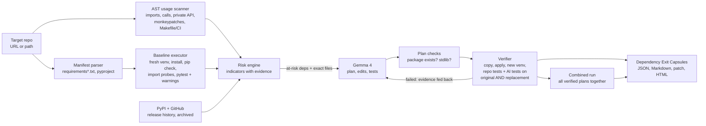

# DepExit

**Evidence-first dependency exit planning, with Gemma 4 proposing and execution deciding.**

Hacktoberfest Hack Day Mumbai × ISTE KJSSE 2026 · Track 1: Gemma 4 · Dependency Resilience · Team 404_TeamNotFound

DepExit points at a Python repository, finds the dependencies that put it at risk, asks Gemma 4 how to get out of each one, and then refuses to believe the answer until it has applied the change to an isolated copy, reinstalled everything, and run the tests. What comes out is a **Dependency Exit Capsule** for every dependency: a JSON record, a readable Markdown page and a patch, in which every single fact is tagged with where it came from.

| Tag | Meaning |
|---|---|
| `OBSERVED` | Read from the repository's files or from PyPI and GitHub metadata. Nothing was executed. |
| `MEASURED` | Produced by running something: an install, an import, the test suite. |
| `AI-SUGGESTED` | Proposed by Gemma 4. Not trusted on its own. |
| `AI · VERIFIED` | A Gemma 4 proposal that DepExit applied and confirmed by execution. |

---

## Results on LinkWatch

A complete run on the organizer's repository is committed in [`examples/linkwatch-run/`](examples/linkwatch-run/). Open [`report.html`](examples/linkwatch-run/report.html) after cloning, or read [`SUMMARY.md`](examples/linkwatch-run/SUMMARY.md) on GitHub. It was produced on 15 October 2026 on a MacBook Air with Python 3.12 and `gemma-4-31b-it` through the Gemini API, and took 13 minutes.

| Measure | Result |
|---|---|
| Dependencies analysed | 16 |
| At risk | 10: Jinja2, nose, MarkupSafe, pydantic, toml, appdirs, requests, setuptools, idna, certifi |
| Gemma 4 plans verified by execution | 10 of 10, each re-checked indicator by indicator |
| LinkWatch's tests before | 9 of 10 passing, 1 warning |
| All verified plans applied together | 23 of 23 passing (10 original + 13 written by Gemma), 0 warnings |

What Gemma proposed, in its own patches: Jinja2 upgraded past the MarkupSafe break, nose removed from the Makefile and requirements, pydantic ported to V2 (`field_validator`, `ConfigDict`), `toml` replaced by `tomllib`, `appdirs` by `platformdirs`, `pkg_resources` by `importlib.resources`, the private `requests` helper replaced with `email.message` and the global monkeypatch removed, the unused `idna` pin dropped, and the undeclared `certifi` import removed. Every plan's prompt, raw response and patch is in its capsule folder.

One honest note: an earlier run marked `requests` verified although Gemma's reply had been truncated and nothing was changed. We found it by reading our own capsule, fixed the parser and added plan validation and per-indicator re-checks (see commit history), and re-ran. The committed run is the fixed one.

## Does it work on other repositories?

Yes, on any Python repository with the usual structure. Nothing in DepExit is specific to LinkWatch. It needs:

- dependencies declared in `requirements*.txt` and/or a PEP 621 `pyproject.toml` (flat or `src/` layout, test extras and dependency groups included);
- a test suite pytest can run (plain `unittest` tests also run under pytest);
- a project that installs on Python 3.12 or 3.13.

As a check, we ran it with no AI (`--ai none`) on a second, unrelated project, [jazzband/prettytable](https://github.com/jazzband/prettytable) (`src/` layout, test extras in `pyproject.toml`). DepExit installed it, ran all 337 of its tests, and ranked its 7 dependencies. That run uncovered four layout bugs (src-layout installs, local-module detection, type-stub packages, compiled mypy helpers), which were fixed the same day.

On a repository in another language (JavaScript, Go, Rust, Java, Ruby, PHP, .NET), DepExit detects the ecosystem from its manifest files, installs and sends nothing, and writes a report that says so. A repository that mixes Python with another language has its Python dependencies analysed, and the report names what was left out.

It does **not** yet support Poetry or Pipenv lock files, `setup.py`-only projects without pyproject, non-Python ecosystems, or test suites that need external services such as a database.

## 1. Problem and solution overview

Maintainers usually find out a dependency is rotten when something breaks. The target repository for this challenge, [rishrek/LinkWatch](https://github.com/rishrek/LinkWatch), is a good example. When you install it exactly as its README says on Python 3.12, one of its ten tests already fails, its `make test-nose` target crashes, and several more problems sit quietly in the manifests waiting for the next upgrade. An AI assistant can suggest fixes for all of this, but a suggestion is not evidence, and a wrong migration in a healthy project is worse than no migration at all.

DepExit splits the job so that each part does what it is good at. Deterministic code does the seeing: it parses every manifest, walks the code with Python's `ast` module to find every import and call site, installs the project in a clean virtual environment, imports each package on its own, runs the test suite, and pulls release history from PyPI and GitHub. Gemma 4 does the thinking: given that evidence and the exact files involved, it chooses a replacement, writes the code edits and requirement changes, and writes small tests that capture the behaviour the repository relies on. Deterministic code then does the judging again: it applies Gemma's plan to a fresh copy, installs it, runs the original test suite and Gemma's own tests against **both** the original dependency and the replacement, and compares the results with the baseline. If the plan fails, the failure is sent back to Gemma for one corrected attempt.

On LinkWatch this surfaces, among others, these problems, each backed by evidence the tool collected itself during the run:

- **Jinja2 2.11.3 + MarkupSafe**: `import jinja2` fails because the unpinned MarkupSafe resolves to 3.x, which removed `soft_unicode`. The report test fails.
- **nose 1.3.7**: imports the `imp` module, which no longer exists on Python 3.12. It is still wired into the Makefile.
- **pydantic**: pinned `==1.10.13` in `requirements.txt` but `>=2` in `pyproject.toml`, so the two documented install paths give different major versions, and the code uses v1-only APIs.
- **setuptools / pkg_resources**: a deprecated API in use at runtime, with a build tool pinned as a runtime dependency.
- **toml, appdirs**: no upstream release in years. Replacements exist in the standard library and in maintained packages.
- **certifi**: imported by the code but never declared. **idna**: pinned to a 2018 release and never imported. **requests**: private `_parse_content_type_header` API in use and `Session.request` monkeypatched at import time.

## 2. Setup instructions

DepExit itself has **no third-party dependencies**. It is pure standard-library Python, so there is nothing to install for the tool.

You need:

- Python **3.11+** to run DepExit (3.12 is fine).
- Python **3.12 or 3.13** for the target repository. LinkWatch does not support 3.14. DepExit looks for `python3.12`, then `python3.13`, or you can pass `--python`.
- `git` on the PATH.
- Internet access to PyPI and GitHub (public endpoints, no keys needed).
- A free **Gemini API key** from [Google AI Studio](https://aistudio.google.com/apikey), which serves the Gemma 4 open-weight models. Alternatively, a local [Ollama](https://ollama.com) with a Gemma 4 model pulled.
- Optional: [`uv`](https://docs.astral.sh/uv/). DepExit uses it automatically if present, which makes the many virtual environments it creates much faster. Plain `pip` works too.

```bash
git clone https://github.com/sabeenaviklar/H26_404_TeamNotFound_xyz
cd H26_404_TeamNotFound_xyz

# macOS / Linux
export GEMINI_API_KEY="your-key"
# Windows PowerShell
$env:GEMINI_API_KEY="your-key"

python -m depexit doctor        # checks interpreters, git, PyPI and a live Gemma call
```

The API key is read from the environment only. It is never written to disk or into the capsules.

## 3. Usage instructions

```bash
# Full run on the organizer's repository (cloned fresh on every run)
python -m depexit analyze https://github.com/rishrek/LinkWatch

# The same, explicit about model and interpreter
python -m depexit analyze https://github.com/rishrek/LinkWatch --ai google --model gemma-4-31b-it --python python3.12

# Only some dependencies, useful for a quick live demo
python -m depexit analyze https://github.com/rishrek/LinkWatch --only jinja2,nose,pydantic

# Local model through Ollama instead of the hosted API
python -m depexit analyze https://github.com/rishrek/LinkWatch --ai ollama --model gemma4

# Evidence only, no AI at all (risk ranking and baseline capsules)
python -m depexit analyze https://github.com/rishrek/LinkWatch --ai none

# Re-verify a saved capsule against the repository later, without calling the model
python -m depexit replay capsule-out/capsules/jinja2/capsule.json
```

A local path works anywhere a URL does. DepExit copies it and never modifies the original.

### What you get in `capsule-out/`

```
capsule-out/
├── report.html             one-page report: ranking, every capsule, provenance tags
├── SUMMARY.md              the same overview in Markdown
├── capsule-index.json      machine-readable summary, baseline evidence, execution log
├── combined.patch          all verified migrations applied together
└── capsules/<dependency>/
    ├── capsule.json        the Dependency Exit Capsule
    ├── CAPSULE.md          human-readable version of it
    ├── patch.diff          exact changes Gemma's plan made
    ├── plan.json           Gemma's final plan (used by `replay`)
    ├── ai_tests.py         tests Gemma wrote for this migration
    └── gemma-attempt-N.prompt.txt / .response.txt   verbatim model transcripts
```

Each capsule contains the fields the challenge asks for: dependency details, risk indicators, usage locations, proposed replacement, migration steps, suggested tests, executed test results, compatibility gaps, and open concerns and limitations. Each field carries its provenance tag.

### Command reference

| Command | Purpose |
|---|---|
| `analyze [TARGET]` | Full pipeline. Options: `--ai auto\|google\|ollama\|none`, `--model`, `--only a,b`, `--all` (also migrate low-risk findings), `--max-deps N`, `--attempts N` (default 2), `--parallel N` (default 3), `--python`, `--installer auto\|pip\|uv`, `--out DIR`, `--no-pyproject-check` |
| `replay CAPSULE [TARGET]` | Apply a capsule's saved plan to a fresh checkout and verify it again. Exit code 0 only if still verified. |
| `doctor` | Pre-flight check of everything a run needs, including one real Gemma call. |
| `render DIR` | Rebuild `report.html` from a finished run's capsules without re-running anything. |

## 4. Architecture



| Module | Responsibility |
|---|---|
| `depexit/manifest.py` | Parses `requirements*.txt` and `pyproject.toml`, normalises names (PEP 503), detects specifier conflicts and commented-out pins. |
| `depexit/scan.py` | `ast` walk of every Python file: imports, later references, private-API access, monkeypatching. Text search of Makefile, Dockerfile and CI files for module and CLI names. |
| `depexit/env.py` | Creates isolated virtual environments (uv or venv + pip), runs installs, `pip check`, per-module import probes and pytest with JUnit XML, and parses warnings. It blames failures on the innermost third-party frame, so pass-through frameworks are not accused. |
| `depexit/pypi.py` | PyPI JSON API and GitHub REST API: release dates, versions behind, yanked releases, archived upstreams. Cached per run as evidence. Also used to check that packages Gemma proposes actually exist. |
| `depexit/analyze.py` | Builds a profile per dependency and turns evidence into risk indicators. Each indicator carries a severity, the evidence string and its provenance. |
| `depexit/gemma.py` | Gemma 4 client (Gemini API REST or local Ollama), prompts, strict JSON extraction, retry on rate limits. |
| `depexit/migrate.py` | Applies plans (exact then indentation-tolerant search/replace, path-safe), edits manifests in place, verifies, compares with the baseline, assigns a verdict, and runs the repair loop and the combined run. |
| `depexit/capsule.py`, `report_html.py` | Writes capsules, the summary and the offline HTML report. |

**Verdicts.** Before anything is applied, a plan must be well-formed (a decision, a rationale, requirement changes and code edits); a reply cut off mid-object is rejected and Gemma is asked again. After applying it, DepExit re-scans and re-installs the changed copy and re-checks **every risk indicator** of that dependency (is the private API still used, do the manifests still disagree, is the stale package still imported). A plan is `verified` only when every such risk is gone, every edit applied, the install and `pip check` succeeded, no baseline test regressed or went missing, every failure and warning DepExit attributed to that dependency is gone, the replacement imports, the old package is no longer referenced, and Gemma's own tests pass on the replacement. `partial` means no regressions but a risk or problem is left over, and the capsule names it. `no-change` means the plan changed nothing, so nothing is claimed as fixed. `failed` means a regression, a broken install, a collection error or a non-existent package. The reasons are always listed.

**Risk indicators.** `IMPORT_FAILS`, `TEST_FAILURES`, `TRANSITIVE_BREAKAGE`, `DEPRECATION_WARNINGS` (measured); `SPEC_CONFLICT`, `UNDECLARED`, `UNUSED`, `TOOLING_ONLY`, `PRIVATE_API`, `MONKEYPATCH`, `UNPINNED` (observed from code and manifests); `STALE_UPSTREAM`, `REPO_ARCHIVED`, `INACTIVE`, `YANKED`, `OUTDATED_PIN`, `OLD_PIN` (observed from registries). A dependency is selected for migration when it has a critical or high indicator or a score of 20 or more.

## 5. Dependencies

DepExit uses only the Python standard library (`ast`, `tomllib`, `subprocess`, `urllib`, `xml.etree`, `difflib`, `venv`, `json`).

| Used at runtime by DepExit | Why | License |
|---|---|---|
| Python ≥ 3.11 | runtime (`tomllib`) | PSF |
| git | cloning the target | GPL-2.0 (invoked as a tool) |
| pip / venv, or uv (optional) | creating isolated environments for the target | MIT / MIT, Apache-2.0 |
| pytest | installed into the *target's* environments by its own requirements; also runs DepExit's unit tests | MIT |
| PyPI JSON API, GitHub REST API | public package metadata, unauthenticated (set `GITHUB_TOKEN` to raise GitHub's rate limit) | public services |

DepExit's own unit tests: `python -m pytest depexit_tests`.

The target repository LinkWatch remains in this fork unchanged (`linkwatch/`, `tests/`, its manifests) under its original MIT license. Its original README is kept at [`docs/LINKWATCH_README.md`](docs/LINKWATCH_README.md).

## 6. AI model details

| Field | Value |
|---|---|
| Model name | Gemma 4 (instruction-tuned) |
| Model version | `gemma-4-31b-it` by default. If that model is rate-limited or has no quota on the key, DepExit falls back to `gemma-4-26b-a4b-it` automatically and records which model produced each plan. |
| Model source | Google DeepMind, open-weight Gemma family |
| Access method | Hosted: Gemini API `v1beta/models/{model}:generateContent` over REST with a free Google AI Studio API key (`GEMINI_API_KEY`, sent as the `x-goog-api-key` header). Local alternative: Ollama `/api/chat` with a Gemma 4 build. |
| License / usage terms | Gemma 4 weights are released under Apache 2.0. Hosted access is additionally subject to the Gemini API Terms of Service and Google's Generative AI Prohibited Use Policy. No paid services are used. |
| Role in the project | For each at-risk dependency, Gemma receives only evidence DepExit collected: the risk indicators, usage locations, the baseline test result and the full text of the files involved. It returns the replacement decision and rationale, migration steps, exact code edits, requirement changes, characterisation tests, compatibility notes and risks. When verification fails, Gemma receives the concrete failure output and returns a corrected plan (up to `--attempts`, default 2). |
| What the model does **not** do | It does not decide risk, does not judge its own success and is not the source of any `OBSERVED` or `MEASURED` field. Its packages are checked against PyPI before use, and its edits are applied only when they match the real file. Every prompt and raw response is saved next to the capsule. |
| Settings | temperature 0.2, single JSON object reply, system instruction in `depexit/gemma.py` |

## 7. Known limitations

- **Verification is bounded by tests.** A plan is proven only on what LinkWatch's ten tests plus Gemma's tests exercise. Untested code paths can still break, and the capsule says so.
- **Isolation then one combination.** Each dependency is migrated and verified on its own, then all verified plans are applied together once. Other subsets and orders are not tested, and two plans that edit the same line can conflict (reported as an unapplied edit in the combined run).
- **Python only.** Manifests supported: `requirements*.txt` and PEP 621 `pyproject.toml`. Poetry, Pipenv, conda and `setup.py` are not parsed. pytest plugins used only through configuration (for example `pytest-cov` via `--cov`) can be reported as unused.
- **Attribution heuristics.** Failures are blamed on the innermost third-party frame and on modules named in the exception. Warnings are blamed by site-packages path, by the repo line that uses a package, or by the package name in the message. This is right for LinkWatch but can misattribute in unusual tracebacks.
- **Model variance.** Gemma's plans differ between runs. The verdict tells you whether a given plan held up, not that the best plan was found. The free API tier is rate-limited, and DepExit backs off and retries, which can slow a full run.
- **Registry signals are a snapshot.** Staleness and archive status come from public metadata at run time. Security advisories are deliberately out of scope for this challenge.
- **Network needed** for cloning, package installs and metadata. A local path plus a warm pip/uv cache reduces this, but installs still need an index.
- **Not yet built:** applying a capsule as a pull request, non-pytest test runners, and multi-repository batch runs.

---

## Original contribution

Everything under `depexit/` and `depexit_tests/` was written during the hackathon. DepExit does not wrap an existing agent framework. The original parts are the evidence model (provenance on every field), the static-plus-execution risk engine, the plan verifier that runs AI-written tests against both the original and the replacement dependency, the evidence-driven repair loop, and the replayable capsule format.

## License

MIT, see [LICENSE](LICENSE). Third-party: LinkWatch (MIT), Gemma 4 (Apache 2.0, accessed under the Gemini API terms).
