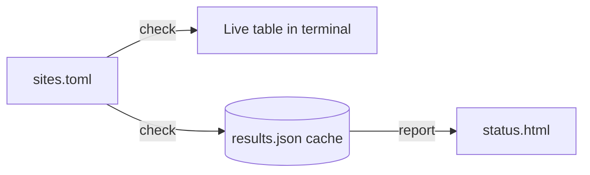

<div align="center">

# 🔭 linkwatch

**Keep an eye on your websites from the terminal.**

A small, friendly link & uptime checker: list your sites in one file, run one command,
and get a live status table plus a clean HTML status page you can host anywhere.


[Quick start](#-quick-start) •
[Usage](#-usage) •
[Configuration](#%EF%B8%8F-configuration) •
[How it works](#-how-it-works) •
[Tests](#-running-the-tests)

</div>

---

## ✨ Features

- 📋 **One config file**: list every site you care about in `sites.toml`
- ⚡ **Live terminal table**: watch results fill in as each site is checked
- 🟢 **Clear status**: UP/DOWN, HTTP status code, response time and page title
- 🕒 **Last-Modified tracking**: see when a page was last updated (when the server reports it)
- 💾 **Cached results**: the last run is saved, so you can build reports any time
- 🌐 **HTML status page**: one command turns your results into a shareable `status.html`
- 🐳 **Docker ready**: run everything without touching your local Python

---

## 🖥️ Preview

```text
$ python -m linkwatch.cli check
                                    My sites
┏━━━━━━━━━┳━━━━━━━━┳━━━━━━┳━━━━━━━━┳━━━━━━━━━━━━━━━━━━━━━━━━━━━━━━━━━┓
┃ Site    ┃ Status ┃ Code ┃   Time ┃ Title                           ┃
┡━━━━━━━━━╇━━━━━━━━╇━━━━━━╇━━━━━━━━╇━━━━━━━━━━━━━━━━━━━━━━━━━━━━━━━━━┩
│ Python  │ UP     │  200 │ 113 ms │ Welcome to Python.org           │
│ PyPI    │ UP     │  200 │  59 ms │ PyPI · The Python Package Index │
│ Example │ UP     │  200 │ 204 ms │ Example Domain                  │
│ GitHub  │ UP     │  200 │ 236 ms │ GitHub                          │
└─────────┴────────┴──────┴────────┴─────────────────────────────────┘
4/4 sites up, results saved to ~/.cache/linkwatch/results.json
```

---

## 🚀 Quick start

You only need **one** of the two options below.

### Option A: Docker (no Python setup needed)

```bash
git clone https://github.com/rishrek/linkwatch.git
cd linkwatch
make docker-build
docker run --rm -it linkwatch python -m linkwatch.cli check
```

### Option B: Local Python 3.12

```bash
git clone https://github.com/rishrek/linkwatch.git
cd linkwatch
make setup                    # creates .venv and installs everything (one time)
source .venv/bin/activate     # do this in every new terminal
python -m linkwatch.cli check
```

<details>
<summary><b>On Windows, or without <code>make</code>?</b></summary>

```powershell
py -3.12 -m venv .venv
.venv\Scripts\activate
pip install -r requirements.txt -r requirements-dev.txt
python -m linkwatch.cli check
```

If your Python 3.12 has a different name on macOS/Linux, pass it to make:
`make setup PYTHON=/path/to/python3.12`

</details>

---

## 📖 Usage

| Command | What it does |
|---------|--------------|
| `python -m linkwatch.cli check` | Checks every site, shows the live table and saves the results |
| `python -m linkwatch.cli report` | Builds `status.html` from the last saved results |
| `python -m linkwatch.cli info` | Shows where the templates and cached results live |
| `python -m linkwatch.cli --help` | Lists all commands and options |

### Options

| Command | Option | Default | Description |
|---------|--------|---------|-------------|
| `check` | `--config PATH` | `sites.toml` | Use a different sites file |
| `report` | `-o, --output PATH` | `status.html` | Where to write the HTML page |
| `report` | `--title TEXT` | `linkwatch` | Heading shown on the status page |

### A typical session

```bash
python -m linkwatch.cli check                     # 1. check your sites
python -m linkwatch.cli report -o status.html     # 2. build the status page
open status.html                                  # 3. view it (xdg-open on Linux)
```

---

## ⚙️ Configuration

All sites live in **`sites.toml`** in the project folder:

```toml
title = "My sites"

[[sites]]
name = "Python"
url = "https://www.python.org"

[[sites]]
name = "Example"
url = "https://example.com"
```

| Key | Required | Description |
|-----|----------|-------------|
| `title` | no | Heading shown above the terminal table |
| `[[sites]]` | yes | One block per site you want to check |
| `name` | yes | Short label for the site |
| `url` | yes | Full address, must start with `http://` or `https://` |

To add a site, copy a `[[sites]]` block and change the name and URL.

### Where results are stored

| System | Location |
|--------|----------|
| macOS | `~/Library/Caches/linkwatch/results.json` |
| Linux | `~/.cache/linkwatch/results.json` |
| Windows | `%LOCALAPPDATA%\linkwatch\linkwatch\Cache\results.json` |

Set the `LINKWATCH_CACHE_DIR` environment variable to keep results somewhere else.

---

## 🧠 How it works



1. **Load**: `sites.toml` is read and validated (every site needs a name and a valid URL).
2. **Check**: each site gets an HTTP GET request, and linkwatch records the status code, response time, page title and `Last-Modified` header.
3. **Save**: results are written as JSON to your cache folder.
4. **Report**: the saved results are rendered into a standalone HTML page with a summary of what's up and what's down.

### Project structure

```text
linkwatch/
├── linkwatch/
│   ├── cli.py            # commands: check, report, info
│   ├── config.py         # reads and validates sites.toml
│   ├── checker.py        # visits each site and collects results
│   ├── encoding.py       # page charset detection and title extraction
│   ├── dates.py          # Last-Modified parsing
│   ├── http_patch.py     # default request headers
│   ├── cache.py          # saves and loads results.json
│   ├── report.py         # builds the HTML status page
│   ├── resources.py      # locates the bundled templates
│   └── templates/
│       └── status.html.j2
├── tests/                # pytest suite with a tiny local test server
├── sites.toml            # your list of sites
├── requirements.txt      # app dependencies
├── requirements-dev.txt  # test dependencies
├── Dockerfile
└── Makefile
```

---

## 🧪 Running the tests

The tests start a tiny local web server, so they don't depend on real websites.

```bash
make test            # locally (activate .venv first)
make docker-test     # inside Docker (run make docker-build first)
```

### Make targets

| Target | Description |
|--------|-------------|
| `make setup` | Create `.venv` and install all dependencies |
| `make test` | Run the pytest suite |
| `make test-nose` | Run the suite with nose |
| `make docker-build` | Build the Docker image |
| `make docker-test` | Run the tests inside Docker |

---

## 🤝 Contributing

Ideas, bug reports and pull requests are welcome. Fork the repo, create a branch,
and open a PR. Please run `make test` before submitting.

## 📄 License

Released under the [MIT License](LICENSE).
